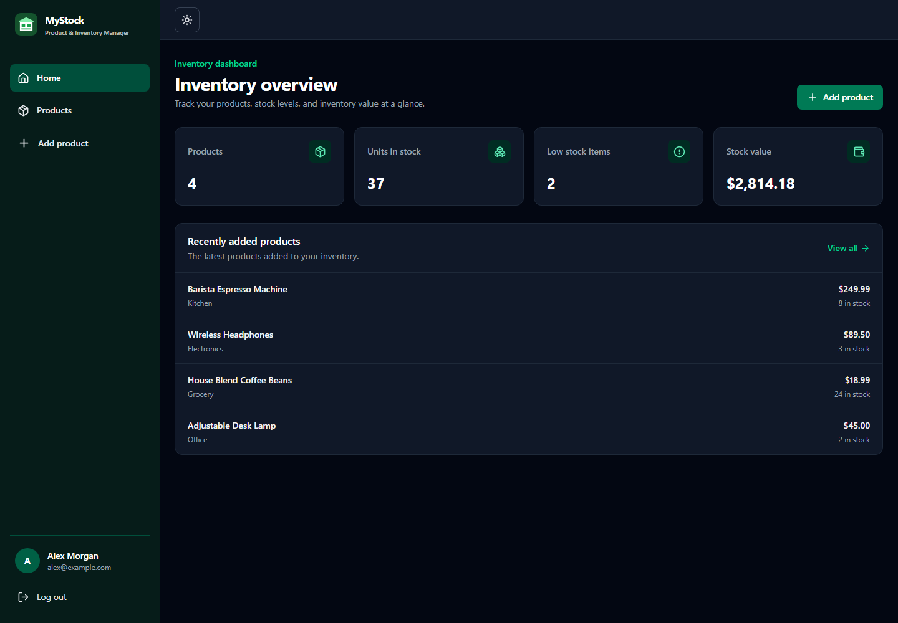
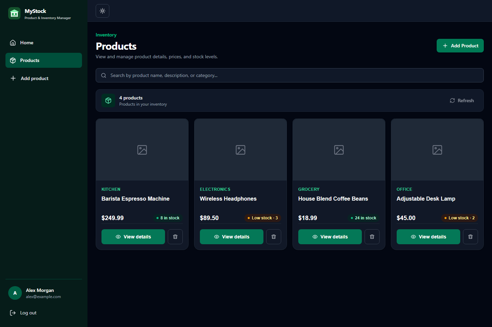

# MyStock

MyStock is a full-stack inventory management website for organizing products and tracking stock. Create an account to add, edit, and delete your products.

The frontend uses React. The API uses Express and Neon PostgreSQL.

## Screenshots

### Dashboard



### Products



Screenshots use sample inventory data.

## Run it on your computer

You need Node.js, npm, and a Neon database.

1. Create a Neon project and copy its connection string.
2. In `backend`, copy `.env.example` to `.env` and put the connection string in `DATABASE_URL`.
3. Open a terminal in `backend` and run:

   ```sh
   npm install
   npm run dev
   ```

4. Open another terminal in `frontend/vite-project` and run:

   ```sh
   npm install
   cp .env.example .env.local
   npm run dev
   ```

   On Windows PowerShell, use `Copy-Item .env.example .env.local` instead of `cp`.

5. Open the Vite address shown in the terminal, usually `http://localhost:5173`, and create an account.

The API creates the database tables when it starts. You can add an image URL without setting up image uploads. To upload image files, add an ImageKit private key to the backend environment.

Each product belongs to the account that created it. On an existing database, the startup migration assigns older shared products to the oldest account so other accounts no longer see them. The API allows up to 120 requests per IP every 15 minutes, with a separate limit of 10 login or registration attempts per IP in the same window. These limits use in-memory storage and reset when the API restarts.

## Environment settings

The backend reads settings from `backend/.env` when you run it locally. Set the same values in your backend hosting service when deploying:

| Name | What it is for |
| --- | --- |
| `PORT` | Port for the API. The hosting service may set this for you. |
| `NODE_ENV` | Use `production` on the hosted API. |
| `FRONTEND_URL` | Frontend origin allowed to call the API and make state-changing requests, such as `https://mystock.example.com` (no path or trailing slash). |
| `JWT_SECRET` | A long, random secret used to sign login tokens. Keep it private. |
| `DATABASE_URL` | Connection string from your hosted PostgreSQL database. |
| `IMAGEKIT_PRIVATE_KEY` | Optional private key for image uploads. |

Set `DATABASE_URL` to your Neon connection string. Never put private keys or database passwords in the frontend environment; variables starting with `VITE_` are included in the built website.

The frontend uses `VITE_API_URL`. In production, set it to `/api`; Vercel forwards those requests to the Render API, so the browser sends the login cookie to the Vercel site.

The API checks the `Origin` header on state-changing requests and accepts the configured `FRONTEND_URL`. Keep this set to the exact production frontend origin. Vercel preview URLs are not accepted unless you deploy with that URL configured.

## Connect to Neon

1. Create a project in Neon and open **Connect** in the Neon Console.
2. Choose your branch, database, and role, then copy the PostgreSQL connection string. Neon connection strings use SSL. For an app with multiple backend instances, choose the pooled connection string; its hostname includes `-pooler`. See the [Neon connection guide](https://neon.com/docs/get-started/connect-neon).
3. Copy `backend/.env.example` to `backend/.env` if you have not already. Set `DATABASE_URL` to the connection string you copied. Keep the URL private; it contains your database password.
4. Start the backend with `npm run dev`. It creates the app tables in Neon when it starts.
5. Check the backend terminal for the message that the API is running.

When `DATABASE_URL` has a value, the backend uses it instead of the local `DB_*` settings. For a hosted app, add the same value as a private environment variable in your backend hosting service.

## Deploy

Push the project to GitHub, then deploy the API to Render and the frontend to Vercel.

### Backend

Create a **Web Service** and set:

- Root Directory: `backend`
- Build Command: `npm ci`
- Start Command: `npm start`

Add these environment variables in Render:

- `NODE_ENV` = `production`
- `FRONTEND_URL` = the Vercel production frontend origin, such as `https://mystock.example.com` (no path or trailing slash)
- `DATABASE_URL` = your Neon connection string
- `JWT_SECRET` = a long, random secret
- `IMAGEKIT_PRIVATE_KEY` = optional, only needed for image uploads

Render sets `PORT` automatically. Check the service logs to confirm the backend started.

### Frontend

Import the same GitHub repository into Vercel and set:

- Root Directory: `frontend/vite-project`
- Framework Preset: `Vite`
- Build Command: `npm run build`
- Output Directory: `dist`
- Environment Variable: `VITE_API_URL` = `/api`

The included `vercel.json` forwards `/api/*` requests to the Render backend and sends React Router paths back to the app, so login cookies stay on the Vercel site and pages such as `/products` continue to work when opened directly or refreshed.

After Vercel assigns a production URL, set `FRONTEND_URL` in Render to that exact origin, then redeploy the backend. If you use a custom domain, set it to the custom frontend origin instead. Keep database passwords and secret keys out of GitHub. Both deployed services use HTTPS, which is needed for login cookies.

## Project files

### Frontend

- `src/App.jsx` contains the page routes and shared providers.
- `src/context/` shares the signed-in user and product list with the pages.
- `src/pages/` contains the dashboard, login, registration, and product screens.
- `src/components/` contains the shared page layout and product form/card.
- `src/api/api.js` sends requests to the backend and handles API errors.
- `src/hooks/useProduct.js` shares product loading between the details and edit pages.
- `src/utils/product.js` converts product data from the API into the frontend format.

### Backend

- `routes/` connects API addresses to the right functions.
- `controllers/` handles login and product requests.
- `models/` contains the PostgreSQL queries.
- `middleware/` checks login and product form data.

## API addresses

| Method | Address | Purpose |
| --- | --- | --- |
| `POST` | `/api/auth/register` | Create an account |
| `POST` | `/api/auth/login` | Log in |
| `GET` | `/api/auth/me` | Get the signed-in account |
| `POST` | `/api/auth/logout` | Log out |
| `GET` | `/api/products` | List products |
| `GET` | `/api/products/:id` | Get one product |
| `POST` | `/api/products` | Add a product |
| `PUT` | `/api/products/:id` | Update a product |
| `DELETE` | `/api/products/:id` | Delete a product |
